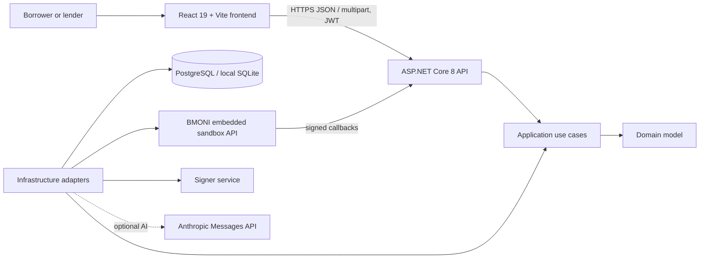

# LMoni Technical Overview

This document explains the current LMoni student-finance application: what users can do, how the frontend and backend are connected, the main technologies, and how the sandbox and deployment configuration work.

## 1. Product and system overview

LMoni is a student-finance demo with two distinct money environments:

1. **Peer-lending platform ledger:** simulated wallet funds, loan contributions, repayments, approvals, and returns stored by the LMoni API.
2. **BMONI embedded sandbox:** partner-side user onboarding, KYC, smart-wallet and bank-account operations, balances, and sandbox transfers.

These environments are separate. A simulated peer-lending credit is not a real deposit, and BMONI sandbox activity is not the peer-lending ledger.

The system is split across two repositories:

- **Frontend:** React application in `frontend/` in this repository.
- **Backend:** .NET API in the separate `BMONI` project/repository, organized into Domain, Application, Infrastructure, and API projects.



## 2. Frontend

### Technologies

- **React 19** for the component-based interface and local interaction state.
- **Vite 8** for local development, environment loading, proxying, and production builds.
- **Plain CSS** in `src/App.css`, using the app's existing color, type, spacing, and surface styles.
- **Browser Fetch API** for backend requests. There is no separate HTTP client dependency or frontend component library in the current package manifest.
- **ESLint** for static code checks.

Main UI files:

- `src/App.jsx` — login and signup, navigation, API request helper, loan and approval flows, and advisory tools.
- `src/components/WalletTools.jsx` — simulated deposits and spend requests.
- `src/components/ActivityTools.jsx` — ledger transaction filters, pagination, and lender returns.
- `src/components/BmoniTools.jsx` — Nigeria KYC, account verification, transfer requests, and BMONI wallet activity.
- `src/App.css` — shared design and responsive styling.
- `vite.config.js` — development proxy configuration.

The client sends a JWT in the `Authorization: Bearer ...` header after login. It sends JSON for normal API requests and `FormData` for KYC file uploads. Mutations that require replay protection include an `Idempotency-Key` header. API errors are surfaced in the view; loading, success, and empty states are shown near the related action or data.

### User-facing features

| Area | What the user can do | Main API calls |
|---|---|---|
| Account | Register as borrower, lender, or both; log in; load current profile | `POST /api/auth/register`, `POST /api/auth/login`, `GET /api/me` |
| Overview | Load health/bootstrap information, dashboard, wallet, score, recent transactions, pending approvals | `GET /api/health`, `/api/bootstrap`, `/api/dashboard`, `/api/wallet`, `/api/score`, `/api/transactions`, `/api/approvals/pending` |
| Wallet | Add simulated funds; create a spend request that becomes an approval | `POST /api/wallet/deposit`, `POST /api/wallet/spends` |
| Loans | Create a request; inspect a loan, assessment, and schedule; contribute; withdraw a contribution; accept terms; request repayment | `/api/loans` and `/api/loans/{id}` routes described below |
| Marketplace | Browse open loans and contribute when the account has the lender role | `GET /api/loans?role=open`, `POST /api/loans/{id}/contributions` |
| Approvals | Inspect pending requests, then confirm or reject them | `/api/approvals/pending`, `/api/approvals/{id}/confirm`, `/api/approvals/{id}/reject` |
| Activity | Filter the ledger by date/type, page through transactions, and view lender returns | `GET /api/transactions`, `GET /api/lender/returns` |
| BMONI sandbox | Submit Nigerian sandbox KYC with sample files; verify a Nigerian bank account; request a transfer approval; load BMONI balances and transactions | `/api/bmoni/...` routes below |
| Advisory | Check a message, optionally verify recipient bank details and amount, or ask a general finance question | `POST /api/scam-check`, `POST /api/assistant/chat` |

### Demo mode

Demo mode is disabled by default. It can be included in a deliberately simulated build with `VITE_DEMO_MODE_ENABLED=true`. The app's local demo data is illustrative and stored in browser storage. BMONI operations use the live configured backend even when the UI demo toggle is enabled; the calls still require an authenticated user and valid backend configuration.

## 3. Backend architecture

The backend targets **.NET 8** and is divided into four projects:

- **`BMoni.Domain`** — business entities and rules, including users and roles, loans, loan contributions, repayments, approvals, wallet ledger entries, scam-check records, and BMONI webhook events.
- **`BMoni.Application`** — request/response contracts, DTOs, service interfaces, authentication use cases, and validation. MediatR is used for auth commands/queries; FluentValidation is registered for request validation. Platform operations are coordinated through `IPlatformService`.
- **`BMoni.Infrastructure`** — EF Core persistence, authentication/password hashing, peer-lending operations, BMONI and signer HTTP adapters, advisory/Anthropic integration, and hosted background workers.
- **`BMoni.Api`** — ASP.NET Core controllers, JWT authentication, Swagger, CORS, rate limiting, exception-to-ProblemDetails handling, and application startup/configuration.

The dependency direction is inward: API and Infrastructure depend on Application; Application depends on Domain. Controllers bind HTTP inputs and call application-level services. Domain rules stay in the domain and infrastructure translates database/partner concerns.

### Backend technologies

- ASP.NET Core Web API and controller routing.
- Entity Framework Core 8, with PostgreSQL through **Npgsql** and SQLite as a local/default fallback.
- **MediatR 12** and **FluentValidation 11** in the Application project.
- **BCrypt.Net-Next** for password hashing.
- **JWT Bearer authentication** for authenticated API calls.
- **Swashbuckle** for OpenAPI/Swagger UI.
- `HttpClientFactory` for BMONI, signer, and Anthropic calls.

On startup, the API applies EF Core migrations and seeds/bootstrap data. `DATABASE_URL` or the configured connection string selects the database. PostgreSQL is selected when the provider is configured as `PostgreSql` or the connection string uses a PostgreSQL URL/host format; otherwise the API uses SQLite.

## 4. Backend endpoint map

All endpoints below use the API origin. Unless explicitly noted as anonymous, account and platform routes require a valid JWT. Role-restricted operations also check borrower/lender authorization server-side.

### Authentication and account

- `POST /api/auth/register` — create an account with email, first name, password, and role flags.
- `POST /api/auth/login` — exchange credentials for an access token.
- `GET /api/me` — return the authenticated user's profile and roles.
- `GET /api/bootstrap` — public readiness, demo-account, loan-rule, and configuration metadata. When `DEMO_USER_PASSWORD` is configured with the required length, bootstrap includes credentials for the seeded demo users; keep that setting restricted to sandbox/demo deployments.
- `GET /api/health` (also `/health`) — API health response.

### Platform, wallet, and loans

- `GET /api/dashboard` — current user's dashboard summary.
- `GET /api/wallet`, `GET /api/score` — wallet and latest score summaries.
- `GET /api/transactions?from=&to=&type=&page=&pageSize=` — paged, filterable user ledger.
- `GET /api/lender/returns` — lender return summary; lender role required.
- `POST /api/wallet/deposit` — simulated wallet deposit; requires `Idempotency-Key`.
- `POST /api/wallet/spends` — create a spend approval request; requires `Idempotency-Key`.
- `GET /api/loans` — list loans; optional `role=open` returns open marketplace requests.
- `POST /api/loans` — create a borrower loan request with amount, purpose, statement, repayment days, and installments.
- `GET /api/loans/{loanId}` and `GET /api/loans/{loanId}/schedule` — loan details and schedule.
- `POST /api/loans/{loanId}/assess` — borrower credit/statement assessment.
- `POST /api/loans/{loanId}/contributions` — lender contribution with terms acknowledgement and `Idempotency-Key`.
- `DELETE /api/loans/{loanId}/contributions/{contributionId}` — lender contribution withdrawal with `Idempotency-Key`.
- `POST /api/loans/{loanId}/accept-terms` — borrower accepts terms; requires `Idempotency-Key`.
- `POST /api/loans/{loanId}/repayments` — create a repayment approval request; requires `Idempotency-Key`.
- `GET /api/approvals/pending`, `POST /api/approvals/{approvalId}/confirm`, `POST /api/approvals/{approvalId}/reject` — review and act on pending requests. Confirmation is idempotent; rejection returns no content.

### BMONI and advisory

- `POST /api/bmoni/onboarding/nigeria` — multipart form KYC and document submission. Each file must be JPEG, PNG, or PDF and no larger than 10 MB; the overall request limit is 22 MB. Use only sandbox personas and sample documents.
- `GET /api/bmoni/balances`, `GET /api/bmoni/transactions` — linked sandbox account activity.
- `POST /api/bmoni/accounts/verify-nigerian` — verify bank code/account number.
- `POST /api/bmoni/transfers` — create a BMONI transfer approval request; requires `Idempotency-Key`.
- `POST /api/scam-check` — message check plus optional bank/account/name/amount checks. Returns risk level, reasons, recommended action, disclaimer, account name when verified, and AI/simulation flags.
- `POST /api/assistant/chat` — advisory answer grounded in the user's platform summary; it cannot authorize a transaction.
- `POST /webhooks/bmoni` — anonymous **inbound partner callback**, authenticated by webhook signature and event ID. It is intentionally not a user-facing frontend action.

## 5. Important business and money flows

### Simulated peer lending

Deposits create simulated ledger credits. Contributions reserve simulated lender funds against a loan. Repayment and spend requests create approvals; confirming an approval performs the corresponding simulated platform operation. Idempotency keys help prevent duplicate processing when clients retry. Loan statuses drive which actions are available, and the backend remains the source of truth for role checks and state transitions.

### BMONI Nigeria onboarding

The frontend gathers the exact form fields expected by `NigeriaOnboardingRequest`, including two document files, and sends them as multipart `FormData`. The backend validates file size/type, creates or links a BMONI user, asks the signer service for wallet operations and owner-proof signing, uploads KYC documents, completes the KYC readiness/activation steps, starts Nigeria onboarding, and records returned partner identifiers/status. The current frontend offers the Bunch Dillon and Samson Jabo sandbox personas wired into the backend's test setup.

### Signer boundary

The API calls a separately hosted signer service through `ISignerClient` for wallet initialization, EIP-191 message signing, and raw-hash signing. `SIGNER_SECRET` authenticates the API-to-signer request. The private signing key is not a frontend setting and must not be shipped in the browser bundle or committed to source control.

### AI and fallback behavior

The advisory service can call Anthropic using `ANTHROPIC_API_KEY` and `ANTHROPIC_MODEL`. The API also has deterministic/rule-based scam indicators and a non-AI chat fallback based on simulated platform facts. AI is optional: responses expose availability/simulation flags, and the core platform does not depend on AI to handle wallet or loan actions. The loan assessment can return neutral AI-unavailable sub-scores when Anthropic is not configured.

### Background processing

The backend hosts workers for:

- loan funding expiry and overdue-loan sweeps (periodic, roughly once per minute);
- BMONI transfer reconciliation (periodic, roughly once per minute when the partner API key is configured);
- processing accepted, deduplicated webhook events (polls pending records every few seconds).

The webhook endpoint only receives partner events; the worker updates local onboarding state asynchronously. BMONI wallet data remains separate from simulated ledger balances.

## 6. Configuration and deployment

### Frontend build-time variables

| Variable | Purpose |
|---|---|
| `VITE_API_BASE_URL` | API origin when the frontend is hosted separately. Leave blank when using the Vite development proxy. |
| `VITE_API_TARGET` | Local Vite proxy target; defaults to `http://localhost:5182`. |
| `VITE_DEMO_MODE_ENABLED` | Include the local demo-mode switch only when set to `true`. |
| `VITE_DEMO_MODE_DEFAULT` | Start the browser session in demo mode only when set to `true`. |

Vite variables are delivered to the browser. **Never put API keys, database credentials, JWT secrets, webhook secrets, or signer secrets in a `VITE_` variable.**

### Backend service variables

Configure production secrets and service settings in the Render service environment (or another server-side secret store), not in the frontend bundle:

- `DATABASE_URL` — PostgreSQL connection URL, or use `ConnectionStrings:Default` with `Database:Provider=PostgreSql`.
- `PORT` — Render's listening port; the API binds to `0.0.0.0` when provided.
- `JWT_SECRET` — signing key; API startup requires at least 32 bytes.
- `DEMO_USER_PASSWORD` — optional password used to seed built-in sandbox accounts; bootstrap exposes these demo credentials, so do not enable this in a production environment with real users.
- `ALLOWED_ORIGINS` — comma-separated frontend origins when frontend and API are on different origins.
- `BMONI_API_KEY`, `BMONI_BASE_URL` — BMONI partner API credentials and environment URL.
- `SIGNER_URL`, `SIGNER_SECRET` — signer service origin and API authentication secret.
- `BMONI_WEBHOOK_SECRET` — webhook signature validation secret.
- `ANTHROPIC_API_KEY`, `ANTHROPIC_MODEL` — optional AI advisory settings.

For local development, the API can load ignored `appsettings.Local.json` in Development and environment variables override configuration. Do not commit populated local settings or secrets. The frontend `.env.local` is also local-only; only non-secret `VITE_` values belong there.

For local frontend development, run the API on port 5182 (or set `VITE_API_TARGET`) and run `npm run dev` from the frontend directory. Vite proxies `/api`, `/swagger`, and `/health` to the API. For Render, build the frontend with `VITE_API_BASE_URL` pointing to the backend origin and configure `ALLOWED_ORIGINS` on the API.

## 7. Security, privacy, and operational notes

- Authentication is JWT Bearer; borrowers and lenders have separate roles, and the API enforces access rules even if the browser hides an action.
- Auth and advisory endpoints have fixed-window rate limits. API exceptions are returned as Problem Details; responses carry an `X-Correlation-ID` for request tracing.
- Passwords are hashed with BCrypt. The frontend removes its session token on an API 401 response.
- KYC uploads are size/content-type constrained on the server and require authentication. Client-side checks are for usability; backend validation is authoritative.
- The BMONI webhook verifies signatures and deduplicates events. The webhook secret must remain on the server.
- Do not enter a real BVN or upload real identity documents in the hackathon demo. Use only partner-provided sandbox identities and sample files.
- The app is a sandbox/demo and does not represent real funds, guaranteed returns, credit decisions, or financial advice.

## 8. Build checks

From the frontend directory:

```bash
npm run build
npm run lint
```

The current frontend uses these checks as its production-build and static-analysis commands. Backend compilation and API behavior should be verified from the backend repository and its configured database/partner environment.
